<p align="center">
    
</p>

<h1 align="center">ilingo</h1>

<p align="center">
    <b>Framework-agnostic i18n for TypeScript: pluggable stores, BCP-47 locale fallback, plurals and Intl formatters.</b><br>
    Stop hand-writing <code>messages[locale]?.[key] ?? messages.en[key]</code> chains, <code>count === 1</code> checks and per-locale <code>Intl</code> calls.<br>
    Catalogs live in code, in lazy chunks or on disk, and the first render on the server already shows the right string.
</p>

<p align="center">
    <a href="https://www.npmjs.com/package/ilingo"></a>
    <a href="https://github.com/tada5hi/ilingo/actions/workflows/main.yml"></a>
    <a href="https://codecov.io/gh/tada5hi/ilingo"></a>
    <a href="https://bundlephobia.com/package/ilingo"></a>
</p>

<p align="center">
    <a href="#why-ilingo"><b>Why ilingo?</b></a>
    ·
    <a href="#packages">Packages</a>
    ·
    <a href="#installation">Installation</a>
    ·
    <a href="#quick-start">Quick start</a>
    ·
    <a href="https://ilingo.tada5hi.net">Documentation</a>
    ·
    <a href="#development">Development</a>
</p>

---

## Why ilingo?

Translating an app starts as a `Record<locale, Record<key, string>>` and an `if`. Then the Austrian user needs the German text, Polish needs three plural forms, prices need the reader's currency format, the catalog grows too big to ship in one bundle, and a missing key shows up as an empty button. Each of those ends up as a helper you write and test yourself.

ilingo is that layer, written once:

| Concern | Hand-rolled `messages[locale][key]` | ilingo |
|---|---|---|
| **Locale fallback** | A `??` chain at every call site, and `de-AT` silently misses when only `de` exists | One chain per lookup: the requested locale, its BCP-47 parents (or your `fallback`), then `en`. The closest locale always wins |
| **Where catalogs live** | One import that bundles every language | Stores: `MemoryStore` in code, `LoaderStore` with a lazy `import()` per locale and namespace, `FSStore` reading files on disk. Several stores are asked in registration order; the first hit wins |
| **Plurals** | `count === 1 ? one : other`, which is wrong for Polish, Arabic or Russian | `definePlural({ one, few, many, other })`, picked by `Intl.PluralRules` for the locale that answered |
| **Numbers, dates, lists** | `Intl.*Format` calls next to the string, with the locale passed by hand | `{{amount, number(style=currency, currency=EUR)}}` in the message, formatted for the resolved locale |
| **Missing keys** | `undefined` or the raw key reaches the UI unnoticed | `onMissingKey` decides what to return; without it, one console warning per key outside production |
| **Server rendering** | An async lookup leaves a placeholder in the server markup, then a hydration mismatch | `getSync()` returns exactly what `get()` would, or throws `SyncUnavailableError` so you know to await |
| **Frameworks and validation** | Glue code per framework and per validation library | `@ilingo/vue`, plus ready-made EN / DE / FR / ES messages for Vuelidate and validup |

A lookup always walks the locale chain first, and the stores inside each locale:

<p align="center">
    
</p>

Because the walk is locale-first, a store registered later never overrides a closer locale, and a slow store (a lazy chunk, a file) is only asked when every store before it missed.

## Packages

| Package | Version | Description |
|---|---|---|
| [`ilingo`](./packages/ilingo) | [](https://www.npmjs.com/package/ilingo) | The core: `Ilingo`, `MemoryStore`, `LoaderStore`, catalog helpers, plurals, formatters, locale negotiation. No framework or Node-specific dependency; CI smoke-tests the build under Node and Bun |
| [`@ilingo/fs`](./packages/fs) | [](https://www.npmjs.com/package/@ilingo/fs) | `FSStore`: loads `<locale>/<namespace>.{js,mjs,cjs,ts,mts,json,conf}` on first use, persists `set()` as JSON, optional watch mode |
| [`@ilingo/vue`](./packages/vue) | [](https://www.npmjs.com/package/@ilingo/vue) | Vue 3 plugin: reactive locale, `useTranslation`, `<ITranslate>`, `<ITranslateT>`, the `v-t` directive, SSR-correct first render |
| [`@ilingo/vuelidate`](./packages/vuelidate) | [](https://www.npmjs.com/package/@ilingo/vuelidate) | Localized Vuelidate validator messages (EN / DE / FR / ES) and the `<IVuelidate>` component |
| [`@ilingo/validup`](./packages/validup) | [](https://www.npmjs.com/package/@ilingo/validup) | Translates [validup](https://www.npmjs.com/package/validup) issues, with EN / DE / FR / ES catalogs for the built-in issue codes. No Vue dependency |
| [`@ilingo/validup-vue`](./packages/validup-vue) | [](https://www.npmjs.com/package/@ilingo/validup-vue) | Vue 3 layer for `@ilingo/validup`: composables and the `<IValidup>`, `<IValidupT>` and `<IFieldValidation>` components |

## Installation

```bash
npm install ilingo
```

ilingo is ESM only and requires Node.js 22 or later on the server. Its runtime dependencies are [`@ebec/core`](https://www.npmjs.com/package/@ebec/core), [`pathtrace`](https://www.npmjs.com/package/pathtrace) and [`smob`](https://www.npmjs.com/package/smob). Add the integration packages from the table above as you need them; each README lists its peer dependencies.

## Quick start

```typescript
import {
    Ilingo,
    MemoryStore,
    defineCatalog,
    defineLocale,
    defineNamespace,
    definePlural,
    defineTranslations,
} from 'ilingo';

const ilingo = new Ilingo({
    locale: 'de-AT',
    store: new MemoryStore({
        data: defineCatalog([
            defineLocale('en', [
                defineNamespace('cart', [
                    defineTranslations({
                        greeting: 'Hello {{name}}',
                        items: definePlural({ one: '{{count}} item', other: '{{count}} items' }),
                        total: 'Total: {{amount, number(style=currency, currency=EUR)}}',
                    }),
                ]),
            ]),
            defineLocale('de', [
                defineNamespace('cart', [
                    defineTranslations({
                        greeting: 'Hallo {{name}}',
                        items: definePlural({ one: '{{count}} Artikel', other: '{{count}} Artikel' }),
                    }),
                ]),
            ]),
        ]),
    }),
});

await ilingo.get({ namespace: 'cart', key: 'greeting', data: { name: 'Peter' } });
// "Hallo Peter": there is no de-AT entry, so its parent de answers

await ilingo.get({ namespace: 'cart', key: 'items', count: 1 });
// "1 Artikel": count picks the plural form and fills {{count}}

await ilingo.get({ namespace: 'cart', key: 'total', data: { amount: 42 } });
// "Total: €42.00": only en has the key, so it is formatted as en

ilingo.getSync({ namespace: 'cart', key: 'total', data: { amount: 42 } });
// "Total: €42.00", synchronously, because MemoryStore answers without I/O

await ilingo.get({ namespace: 'cart', key: 'checkout' });
// undefined, and one "[ilingo] missing translation" warning outside production
```

The [core README](./packages/ilingo/README.md) covers every option, store and helper. The [documentation site](https://ilingo.tada5hi.net) adds guides on catalog design, lazy loading, formatters and server rendering.

## Development

```bash
npm install                    # install all workspaces
npm run build                  # build every package (Nx, topological order)
npm run test                   # Vitest in every package with a test suite
npm run lint                   # ESLint across the repository
npm run dev -w @ilingo/docs    # the documentation site, after a build
```

Commits follow [Conventional Commits](https://www.conventionalcommits.org); release-please derives versions and changelogs from them.

## License

Made with 💚

Published under [MIT License](./LICENSE).
